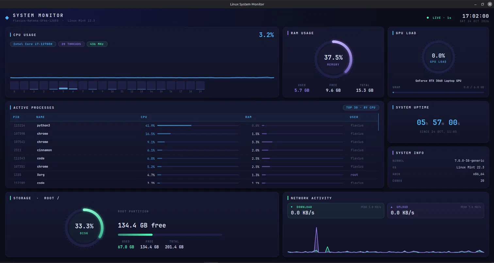
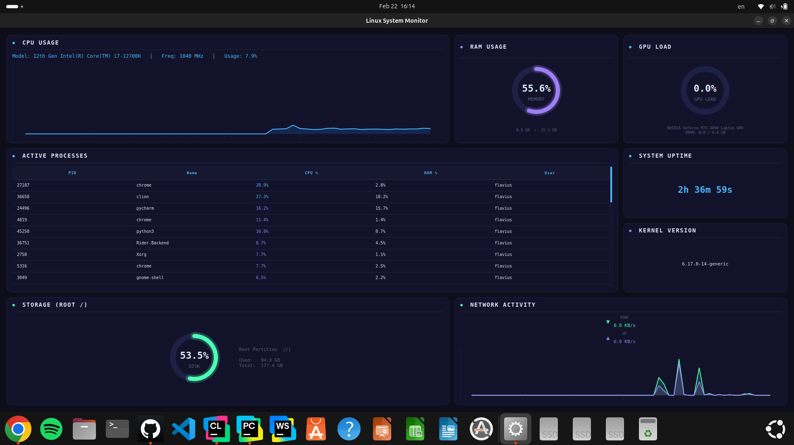

# 🖥️ System Monitor

A fast, good-looking system monitoring dashboard for Linux.
Built with a **C backend** that reads system data straight from `/proc` and a **Python (PyQt6) frontend** with a dark, neon-style interface.



## ✨ Features

* **⚡ Native C backend:** reads metrics directly from `/proc`, `statvfs` and `uname`, with no extra tools needed (except `nvidia-smi` for the GPU).
* **📊 CPU:** live usage graph, model, thread count, current frequency and **per-core usage bars**.
* **🧠 RAM:** animated circular gauge with used / free / total.
* **🎮 GPU:** NVIDIA GPU load and VRAM usage.
* **📋 Processes:** top 30 processes by CPU, with CPU % and RAM % bars and the owning user.
* **💽 Storage:** root partition (`/`) gauge, capacity bar and used / free / total.
* **🌐 Network:** live download / upload speeds, peak values and a history graph.
* **⏱️ System info:** uptime (plus boot time), kernel, distribution, architecture and core count.
* **🕒 Header:** hostname, distribution, live indicator and clock.

## 🆕 What's new in v2

* Redesigned UI (same color palette): gradient cards with shadows, animated gauges, chips, per-core bars, inline bars in the process table, a new header and a System Info card.
* The process list is now read **directly from `/proc`** instead of `popen("ps")`, so it works on distributions where `ps` output can't be read (for example, Linux Mint).
* Font fallback for Linux (JetBrains Mono → Fira Code → DejaVu Sans Mono), since Consolas doesn't exist on Linux.

<details>
<summary>v1 screenshot</summary>



</details>

## 📦 Requirements

Tested on **Ubuntu 24.04** and **Linux Mint 22.3**.

Install the system packages:

```bash
sudo apt update
sudo apt install build-essential python3 python3-pip python3-venv
```

Optional, but recommended:

```bash
# Font used by the UI (if it's missing, the app falls back to DejaVu Sans Mono)
sudo apt install fonts-jetbrains-mono

# Qt/xcb libraries, only needed if PyQt6 fails to start with an "xcb" plugin error
sudo apt install libxcb-cursor0
```

For **GPU monitoring** you need the NVIDIA proprietary drivers, which provide `nvidia-smi`. Without them, the GPU card shows "NVIDIA GPU Not Found" and everything else keeps working.

Python dependencies (installed in step 3 below): `PyQt6`, `pyqtgraph`.

## 🚀 Installation & Setup

**1. Clone the repository**
```bash
git clone https://github.com/FlaviusMarian27/System-Monitor
cd System-Monitor
```

**2. Compile the C backend**
```bash
mkdir -p build
gcc -shared -fPIC -o build/libmonitor.so src/backend/*.c
```
> Always recompile after cloning on a new machine. The `.so` file is specific to the system it was built on.

**3. Set up the Python virtual environment**
```bash
python3 -m venv .venv
source .venv/bin/activate
pip install -r requirements.txt
```

## 🎮 Usage

**Run from the terminal:**
```bash
chmod +x run.sh
./run.sh
```

**Create a desktop shortcut (Ubuntu / Mint / Debian):**
```bash
chmod +x create_shortcut.sh
./create_shortcut.sh
```
*After that, double-click the "Linux System Monitor" icon on your desktop.*

## 📂 Project Structure

```text
System-Monitor/
│
├── build/                   # Generated shared library (not committed)
│   └── libmonitor.so        # The compiled C library used by Python
│
├── screenshots/             # README screenshots (v1, v2)
│
├── src/
│   ├── backend/             # C backend (low-level system data)
│   │   ├── include/         # Header files (.h)
│   │   │   ├── core.h       # Main struct sent to Python
│   │   │   ├── cpu.h        # CPU usage and frequency
│   │   │   ├── disk.h       # Storage
│   │   │   ├── gpu.h        # NVIDIA GPU
│   │   │   ├── memory.h     # RAM usage
│   │   │   ├── network.h    # Download/upload speed
│   │   │   ├── processes.h  # Active processes
│   │   │   └── sysinfo.h    # Uptime and kernel
│   │   │
│   │   ├── core.c           # Links all modules together
│   │   ├── cpu.c            # Parses /proc/stat and /proc/cpuinfo
│   │   ├── disk.c           # Storage info via statvfs
│   │   ├── gpu.c            # GPU data via popen("nvidia-smi")
│   │   ├── memory.c         # Parses /proc/meminfo
│   │   ├── network.c        # Network speeds from /proc/net/dev
│   │   ├── processes.c      # Top processes from /proc/<pid>/stat
│   │   └── sysinfo.c        # Uptime and kernel (uname, sysinfo)
│   │
│   └── frontend/
│       └── main.py          # PyQt6 app: UI, gauges, ctypes bridge
│
├── .venv/                   # Python virtual environment (not committed)
├── create_shortcut.sh       # Creates a trusted desktop shortcut
├── icon.png                 # App icon
├── README.md
├── requirements.txt         # Python dependencies (PyQt6, pyqtgraph)
└── run.sh                   # Activates the venv and starts the app
```

## 🤝 Contributing
Feel free to fork the project, open a pull request, or open an issue if you find a bug.

## 📜 License
This project is open-source and available under the MIT License.